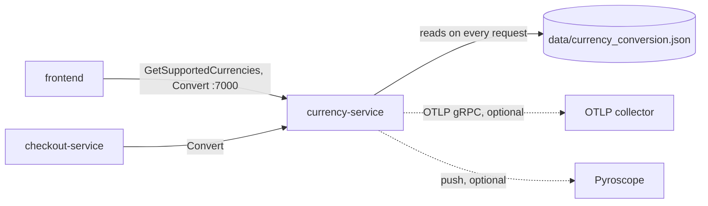
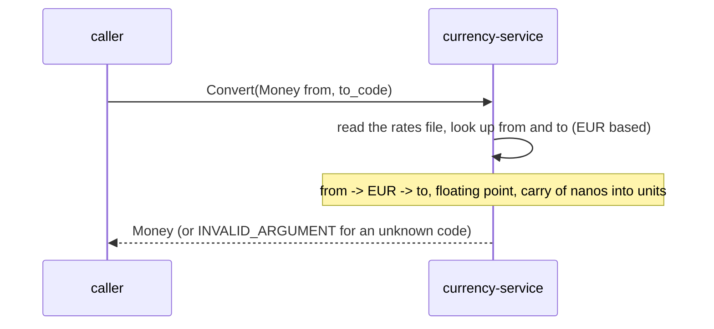

# Architecture

## Context

currency-service is stateless and calls no other service. The rates are a static file baked into the image. The callers were checked in the `origin/main` code of the frontend (`cmd/server/rpc.go`, with its own cache in front, see the frontend's ADR 2) and checkout-service (`Convert` for items and shipping) on 2026-11-21.

## Conversion

## Components

| File | Role |
|---|---|
| `src/server.ts` | gRPC server bootstrap, the handlers (`GetSupportedCurrencies`, `Convert`, health `Check`), reflection, SIGTERM drain |
| `src/currency.ts` | the pure conversion logic (carry, `convertMoney`), unit tested |
| `src/telemetry.ts`, `telemetryConfig.ts`, `logger.ts`, `fatal.ts` | OTel SDK, RPC metrics, runtime gauges, Pyroscope (each only when enabled), pino JSON logs with trace ids, fatal handler |
| `proto/` | `currency.proto` and `health.proto`, loaded at runtime by `@grpc/proto-loader` |
| `data/currency_conversion.json` | EUR-based rates for 33 currencies |

## Decisions

[ADR 1](adr/0001-static-eur-rates-file.md).
